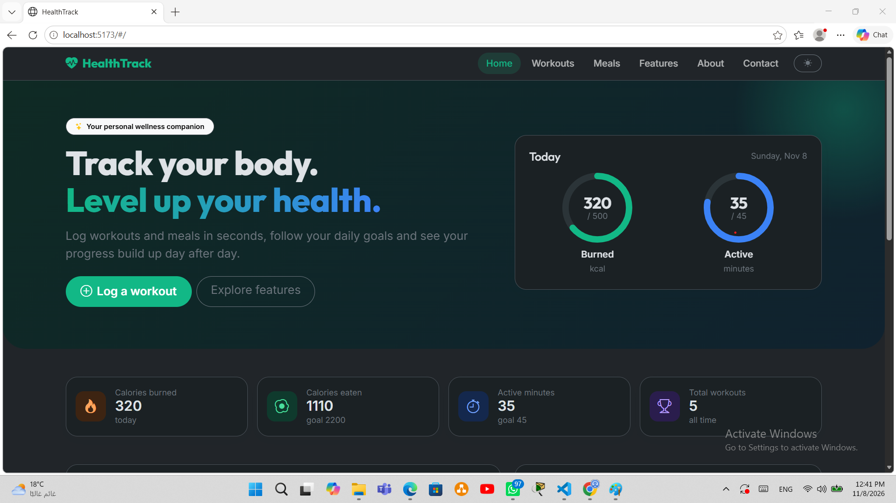
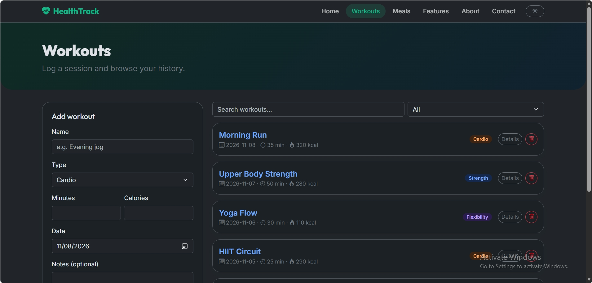
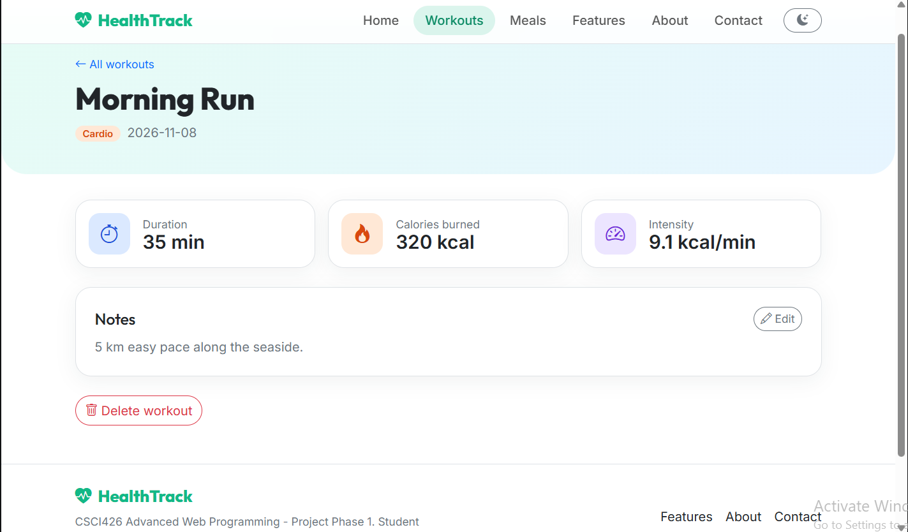
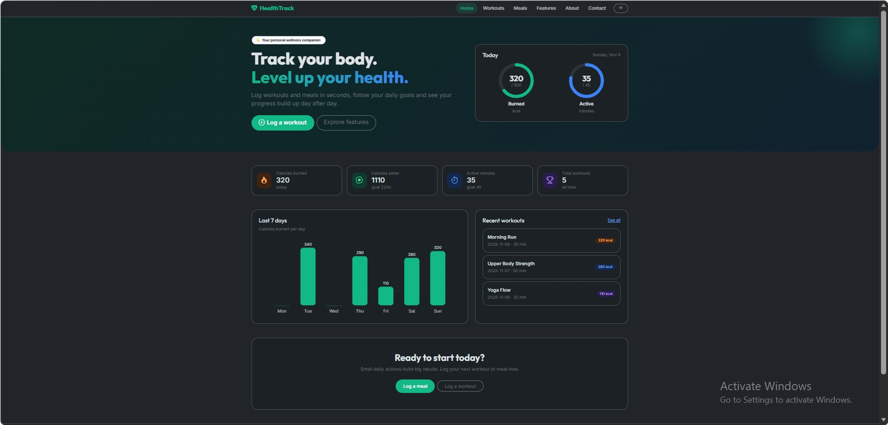

# HealthTrack

A personal wellness tracking web application built for **CSCI426 Advanced Web Programming - Project Phase 1** (theme 6: HealthTrack).

Users can log workouts and meals, set daily goals, and follow their progress with progress rings and a weekly chart. All data is stored in the browser (`localStorage`), so no backend is needed.
https://app.netlify.com/projects/healthtrack-appp/configuration/general

## Features

- Home dashboard with today's stats, progress rings and a 7-day calories chart
- Workouts page: add, search, filter by type and delete workouts
- **Dynamic page** `/workouts/:id` with workout details and editable notes
- Meals page with a daily calorie ring and meal history
- Features, About and Contact pages (Contact form has validation)
- Dark / light mode saved between visits
- Fully responsive (Bootstrap grid, collapsing navbar)

## Pages and routes

| Route | Page |
| --- | --- |
| `/` | Home |
| `/about` | About |
| `/features` | Features |
| `/workouts` | Workouts list + form |
| `/workouts/:id` | Workout details (dynamic) |
| `/meals` | Meals |
| `/contact` | Contact |

## Technologies

- React 18 + React Router 6 (HashRouter)
- Bootstrap 5.3 and Bootstrap Icons
- Vite
- Context API for state, `localStorage` for persistence

## Setup instructions

Requirements: Node.js 18 or newer.

```bash
npm install
npm run dev        # start the dev server
npm run build      # production build in /dist
npm run preview    # preview the build locally
```

## Deployment

**GitHub Pages**

```bash
npm run deploy
```

Then in the repository settings, set Pages to serve from the `gh-pages` branch.

**Netlify / Vercel:** import the repository, build command `npm run build`, output directory `dist`.

## Project structure

```
src/
  components/   NavBar, Footer, ProgressRing, StatCard, WeeklyChart
  context/      HealthContext (state + localStorage)
  pages/        Home, About, Features, Workouts, WorkoutDetails, Meals, Contact, NotFound
  index.css     custom theme on top of Bootstrap
```

## Screenshots

Add screenshots to a `screenshots/` folder and link them here:






## Credits

Built by the student author for the course. Icons: Bootstrap Icons (MIT). Fonts: Outfit and Inter (Google Fonts, OFL). No pre-built templates were used.
